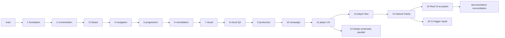

# G4 merge readiness — review snapshot, not merge authorization

Audit date: 2026-11-03. Authoritative entry: [00-START-HERE.md](00-START-HERE.md); current acceptance: [ADR-0006](../adr/ADR-0006-g4-checkpoint-acceptance.md). Source snapshot and complete changed-file inventory: [PR audit JSON](../evidence/g4-exit/pr-audit.json). REST PR/files/reviews/comments/check-runs and GraphQL thread/mergeability queries were fetched with pagination; zero unresolved review threads and zero formal submitted reviews were returned across PRs1–15. PR15 has one owner acceptance conversation comment; it is not a formal GitHub approval or merge permission.

## Mandatory owner decision before integration

**OWNER DECISION REQUIRED — MAIN POLICY.** AGENTS says **Never merge to or modify `main`**. PR #1 targets main. Consequently the topological order below is a dependency description, not an executable merge plan under current operating constraints. Acceptance of PR15, green CI, and ADR-0006 do not override this prohibition.

The owner must separately decide and record the permitted integration destination, authorized actor, and any required operating-policy treatment before any integration can proceed. Until that decision exists, no agent may execute the proposed main-target sequence. Do not infer an exception from this report. The prohibition is unchanged and this remediation authorizes no merge.

Authority: AGENTS defines operating constraints; [00-START-HERE.md](00-START-HERE.md) is the entry point; approved later owner-authorized ADRs define decisions; other active specs conform. Ambiguous conflicts must be recorded and referred to the owner, never silently resolved.

## Dependency graph and topological order

Edges are actual base/head branch relationships and verified Git ancestry, not assumptions from PR numbers. Every base→head ancestry check passed. All fifteen original PRs are OPEN and UNMERGED. PR1–3 are non-draft; PR4–15 are Draft. GitHub returned mergeable for all at the captured snapshot; this is not a guarantee after integrations.

A valid original-stack topological order is **1 → 2 → 3 → 4 → 5 → 6 → 7 → 8 → 9 → 10 → 11 → 12 → 14 → 15**. PR13 may be considered separately after11, but is not on the production path. It shares only PR11 ancestry with12; its20 changed files are entirely `docs/art-direction/g4a/`, without code. PR14 read/adapted those references and licensed font candidates without merging13. Do not merge13 automatically or interpret its three proposed directions as three approved themes.

## Exact PR inventory

| PR | Head branch / SHA | Base branch / SHA | Draft | Changed files | Latest run (event / conclusion) |
|---|---|---|---|---:|---|
| [#1](https://github.com/Yoseftext/layer-sort/pull/1) | `feat/gdscript-foundation` / `f85172c16754e555b93f85cf15e9fd56ab6c90d3` | `main` / `6c13a076061d8414496b439f7fc341b3811337dd` | no | 29 | [40103944842](https://github.com/Yoseftext/layer-sort/actions/runs/40103944842) pull_request / success |
| [#2](https://github.com/Yoseftext/layer-sort/pull/2) | `feat/agent-qa-orchestration` / `4b2d3138df103178e93f7168ea2dba1a00f87c76` | `feat/gdscript-foundation` / `f85172c16754e555b93f85cf15e9fd56ab6c90d3` | no | 50 | [40178439053](https://github.com/Yoseftext/layer-sort/actions/runs/40178439053) pull_request / success |
| [#3](https://github.com/Yoseftext/layer-sort/pull/3) | `feat/g2-core-gameplay` / `775dd6c2222827c70371c0d621bba47b570151ce` | `feat/agent-qa-orchestration` / `4b2d3138df103178e93f7168ea2dba1a00f87c76` | no | 45 | [40229299952](https://github.com/Yoseftext/layer-sort/actions/runs/40229299952) pull_request / success |
| [#4](https://github.com/Yoseftext/layer-sort/pull/4) | `feat/g3a-navigation` / `96e56a30144a2ba85aa58047718235b8f78b3653` | `feat/g2-core-gameplay` / `775dd6c2222827c70371c0d621bba47b570151ce` | yes | 26 | [40275536509](https://github.com/Yoseftext/layer-sort/actions/runs/40275536509) pull_request / success |
| [#5](https://github.com/Yoseftext/layer-sort/pull/5) | `feat/g3b-progression` / `20b0755cbcf3c869237c7b7f90fe720b68012978` | `feat/g3a-navigation` / `96e56a30144a2ba85aa58047718235b8f78b3653` | yes | 16 | [40311425378](https://github.com/Yoseftext/layer-sort/actions/runs/40311425378) pull_request / success |
| [#6](https://github.com/Yoseftext/layer-sort/pull/6) | `feat/g3b-remediation` / `87b562e09b48871fe295e80cfb0fe27f3529c8ab` | `feat/g3b-progression` / `20b0755cbcf3c869237c7b7f90fe720b68012978` | yes | 16 | [40466309539](https://github.com/Yoseftext/layer-sort/actions/runs/40466309539) pull_request / success |
| [#7](https://github.com/Yoseftext/layer-sort/pull/7) | `feat/g4-gameplay-visual` / `395d46f8281e8ee5de0a32fdf3262a5322caf48f` | `feat/g3b-remediation` / `87b562e09b48871fe295e80cfb0fe27f3529c8ab` | yes | 14 | [40782247525](https://github.com/Yoseftext/layer-sort/actions/runs/40782247525) pull_request / success |
| [#8](https://github.com/Yoseftext/layer-sort/pull/8) | `feat/cloud-visual-qa` / `d190e317930f242c629d4ac88542d6ad1ce2f391` | `feat/g4-gameplay-visual` / `395d46f8281e8ee5de0a32fdf3262a5322caf48f` | yes | 8 | [41394377247](https://github.com/Yoseftext/layer-sort/actions/runs/41394377247) pull_request / success |
| [#9](https://github.com/Yoseftext/layer-sort/pull/9) | `feat/g4-visual-production` / `4a8caf7f9dc852cdf381dec6dac38aa78bc28cf3` | `feat/cloud-visual-qa` / `d190e317930f242c629d4ac88542d6ad1ce2f391` | yes | 26 | [41399428088](https://github.com/Yoseftext/layer-sort/actions/runs/41399428088) pull_request / success |
| [#10](https://github.com/Yoseftext/layer-sort/pull/10) | `feat/g3c-classic-campaign` / `92462569ee9c327d0895cb60b1eea53fb9de029c` | `feat/g4-visual-production` / `4a8caf7f9dc852cdf381dec6dac38aa78bc28cf3` | yes | 24 | [41403429738](https://github.com/Yoseftext/layer-sort/actions/runs/41403429738) push / success |
| [#11](https://github.com/Yoseftext/layer-sort/pull/11) | `feat/g3c-player-ux` / `1f6289a00d0998597d90cc467d0d023953e92db3` | `feat/g3c-classic-campaign` / `92462569ee9c327d0895cb60b1eea53fb9de029c` | yes | 19 | [41439747055](https://github.com/Yoseftext/layer-sort/actions/runs/41439747055) push / success |
| [#12](https://github.com/Yoseftext/layer-sort/pull/12) | `feat/g3d-player-flow` / `dafc73398af9dd990fed729a23b60903101ab90b` | `feat/g3c-player-ux` / `1f6289a00d0998597d90cc467d0d023953e92db3` | yes | 118 | [41475429268](https://github.com/Yoseftext/layer-sort/actions/runs/41475429268) workflow_dispatch / success |
| [#13](https://github.com/Yoseftext/layer-sort/pull/13) | `docs/g4a-art-direction` / `b2b58dfe7fd120fa01c7776a7e40d12a021c8853` | `feat/g3c-player-ux` / `1f6289a00d0998597d90cc467d0d023953e92db3` | yes | 20 | No run at this head |
| [#14](https://github.com/Yoseftext/layer-sort/pull/14) | `feat/g4b-optical-clarity` / `24809327f45f0d7ee4633e67456a03def74471a4` | `feat/g3d-player-flow` / `dafc73398af9dd990fed729a23b60903101ab90b` | yes | 71 | [41577090746](https://github.com/Yoseftext/layer-sort/actions/runs/41577090746) workflow_dispatch / success |
| [#15](https://github.com/Yoseftext/layer-sort/pull/15) | `feat/real-game-ui` / `c961972365258baa34cae279dfc10ab46edce2f7` | `feat/g4b-optical-clarity` / `24809327f45f0d7ee4633e67456a03def74471a4` | yes | 106 | [41626811037](https://github.com/Yoseftext/layer-sort/actions/runs/41626811037) workflow_dispatch / success |

## Repeated files, conflicts and consolidation

No direct base/head conflict was reported by GitHub for the captured original PRs. Repeated edits are expected along ancestry, not independent duplicate features. Highest overlaps: `scripts/ui/classic_game.gd` in11 PRs, `navigation_coordinator.gd` in10, `android-build-g3b.yml` in10, `ui_text.gd` in7, `settings_screen.gd` in7, `home_screen.gd` and `export_presets.cfg` in6 each. Review the cumulative accepted tree before deciding an earlier prototype choice still controls. Exact per-PR files are in the audit JSON.

**Recommend keeping the original reviewed layers separate** to preserve evidence attribution and rollback points. Do not squash/rebase intermediate shared branches: descendants depend on their exact commits and squash merging a lower layer can make subsequent diffs misleading. If the owner authorizes integration, normal merge commits preserve ancestry better; after each layer recompute base/head, diff and checks before changing the next target. Existing targets remain unchanged in this task. GitHub may automatically retarget dependents when a head branch is merged or removed: verify rather than assume; do not delete branches.

Consolidation into one PR could reduce administrative steps but would create a very large foundation-to-G4 diff, combine historical code and evidence, bypass individual review, and require a separately approved integration strategy. It is not recommended now and was not performed. CI repair is a sibling of15 at14, so later integration of both touches the workflow; reconcile filters while retaining15's added regression step. Documentation stacks on15, separate from the CI-only base. No unrelated bases are combined into a single PR.

## Per-layer risks and required review

All layers require explicit owner merge authorization and current relevant checks; no formal approval currently exists in the snapshot.

| PR | Review focus / integration risk |
|---|---|
| 1 | Foundation/toolchain/export identity and pin review; G1 smoke is not gameplay QA. |
| 2 | Agent policy/tool permissions and QA boundaries; optional Shizuku must remain optional. |
| 3 | Classic atomic commits, Undo and legacy prototype choices; later UI changes supersede presentation choices. |
| 4 | Back/Pause/route lifecycle and unsaved-attempt confirmations. |
| 5 | Progression/dual-slot save compatibility and recovery; inspect later remediation before treating first implementation as final. |
| 6 | Save validation/write failures/migration and version/package guards. |
| 7 | Animation synchronization/input lock and rendering ownership. |
| 8 | Cloud harness changes and evidence provenance; Linux is not OPPO GPU proof. |
| 9 | Audio provenance/focus and low-tier rendering resource budgets. |
| 10 | Individual level1–14 fixtures, solver proof and existing-save level identity. |
| 11 | Touch scroll tap-versus-drag, exact Play resume and fast-touch input. |
| 12 | Direct Next/Replay/Map duplicate-transition guards; large evidence-only delta. |
| 13 | Parallel proposed design research, no production dependency; do not treat all A/B/C proposals as approved. |
| 14 | Exact font binary licenses, scoped typography and material depth; stylized liquid is accepted/deferred polish. |
| 15 | About return contexts, icon accessibility/modal input isolation; preserve accepted APK and defer polish. |

Required reviewers: repository integrator for actual ancestry/workflow/export changes, game engineer for cumulative domain/session/save invariants, license/security reviewer for fonts/audio/tool dependencies, and owner for acceptance plus merge authorization. Existing independent agent code/render reviews are recorded in historical reports; they are not formal PR approvals. Accepted minor polish is explicitly deferred and is not a blocker to this documentation/CI review. Do not reopen it.

## Required checks and event evidence

Preserve existing job/artifact names and permissions. Relevant CI checks are `Godot 4.7.2 Standard — G1 portrait APK`, `G1.5 static and oracle regression checks (no phone)`, `Godot 4.7.2 Standard — G2 Classic APK`, `Godot 4.7.2 Standard — G3-A navigation APK`, and `Godot 4.7.2 Standard — G3-B navigation APK` as appropriate to each layer. These are recommended integration requirements; repository branch-protection enforcement is not inferred from their presence. Re-evaluate required checks on the exact integration result before each merge. G4's accepted checkpoint CI41626811037 succeeded by workflow_dispatch; it does not establish automatic PR triggers. PR10/11 snapshot has push runs only; PR12/14/15 dispatch only;13 has none.

The independent [CI repair PR16](https://github.com/Yoseftext/layer-sort/pull/16), head `28eebd0005147c97b673fde66b485d8ef2750f48`, bases on exact PR14 `24809327f45f0d7ee4633e67456a03def74471a4`. It changes only push/base-branch filters, preserving dispatch, concurrency, permissions, jobs and artifact consumers. Actual automatic [push41661341370](https://github.com/Yoseftext/layer-sort/actions/runs/41661341370) and [pull_request41661356285](https://github.com/Yoseftext/layer-sort/actions/runs/41661356285) both completed **SUCCESS** at exact head `28eebd0005147c97b673fde66b485d8ef2750f48`, rather than being substituted with dispatch. This proves the repair branch's event configuration, not that unmerged PR15 or its unchanged base has retroactively acquired the fix. No direct base edit or retarget was made.

Local relevant checks: `git diff --check`; YAML parse and non-trigger-key identity assertions on CI repair; documentation reference validation. actionlint was unavailable and is disclosed as SKIP; no dependency was installed. No gameplay/phone tests are repeated for documentation changes.

## Known QA and acceptance limits

Owner accepts PR15 with minor non-blocking polish deferred and reports10/10 physical-device groups passed ([comment](https://github.com/Yoseftext/layer-sort/pull/15#issuecomment-6606381017)). Do not substitute owner report for agent-run device logs, benchmark values or per-ID test matrix. No raw phone evidence was acquired in this task. Existing ObjectDB/resource-at-exit warnings remain documented; stylized tilted liquid, low-brightness tuning and other accepted polish are deferred rather than reopened. G15-QA-001 remains OPEN pending its own unobscured-capture/negative-fixture/owner acceptance criteria. Rules contract remains Draft. G4 acceptance is not full MVP, release or integration completion; G5 Circuit15–20 remains unauthorized for implementation.

## Conditional integration proposal — blocked by main-policy decision

1. First obtain the explicit owner main-policy/destination/actor decision above; do not execute this proposal until the constraint is resolved in the governing records. Review CI repair and this documentation independently; preserve accepted PR15/APK. Approve no gameplay changes as part of this gate.
2. Approve the integration strategy explicitly. Keep stack ancestry; no rebase/force-push/silent retarget or branch deletion. PR13 stays optional parallel design history.
3. Only after the main-policy decision and separate merge authorization are recorded, the proposed dependency path is 1–12, then14. Refresh diff/mergeability/checks at every layer; older smoke-only checks cannot substitute for final cumulative gameplay regression.
4. After14 is integrated under the authorized strategy, handle CI16 and accepted15 as sibling layers. Apply CI16 before or alongside15 so both automatic event paths can be checked on the resulting integration. Review workflow overlap rather than overwriting15 tests. Then integrate documentation based on15; future retargeting, if needed, is an owner-reviewed operation.
5. Run full CI on the exact resulting integration commit, verify APK provenance and preservation compatibility, and record final owner integration acceptance. Do not claim G4 fully merged before this exists.

Current verdict: **READY WITH KNOWN LIMITATIONS** for documentation owner review; **integration is BLOCKED pending the explicit owner main-policy decision**. No PR is merged or marked ready by this report; all integration remains pending explicit approval. Rollback this reconciliation by reverting its normal commit on a review branch, preserving saves and all accepted source history.

## Workspace preservation

Parent recorded before/after SHA-256 manifests outside the original worktree. Original `/workspace/layer-sort-ui` HEAD remains `c961972365258baa34cae279dfc10ab46edce2f7`; Git status and all530 tracked/untracked file hashes match, including all76 untracked paths. Original main remains `6c13a076061d8414496b439f7fc341b3811337dd`. Detached audit worktree `/workspace/layer-sort-ui-g4-audit` began clean at c961972; this docs branch uses its own clean worktree `/workspace/layer-sort-g4-docs` from the same parent. Preservation PASS; no discrepancy reported.
