# Genuine Godot before/after comparison

Same scripted scenarios at baseline PR12 and this gameplay implementation. No mockups or image retouching. 720×1600 except narrow600×1600 logical viewport. Screens captured directly from Godot viewport. Hashes and sampled-animation procedure in capture-provenance.json.

| Scenario | Before | After |
|---|---|---|
| 3-tubes-en | 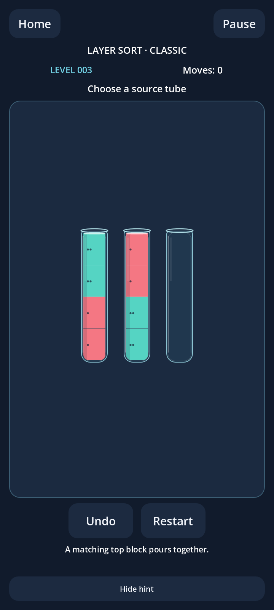 | 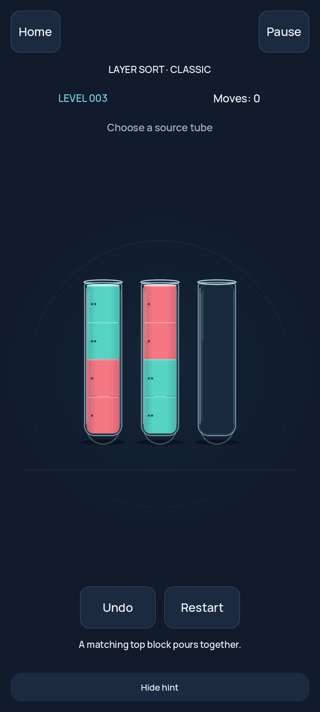 |
| 4-tubes-ar | 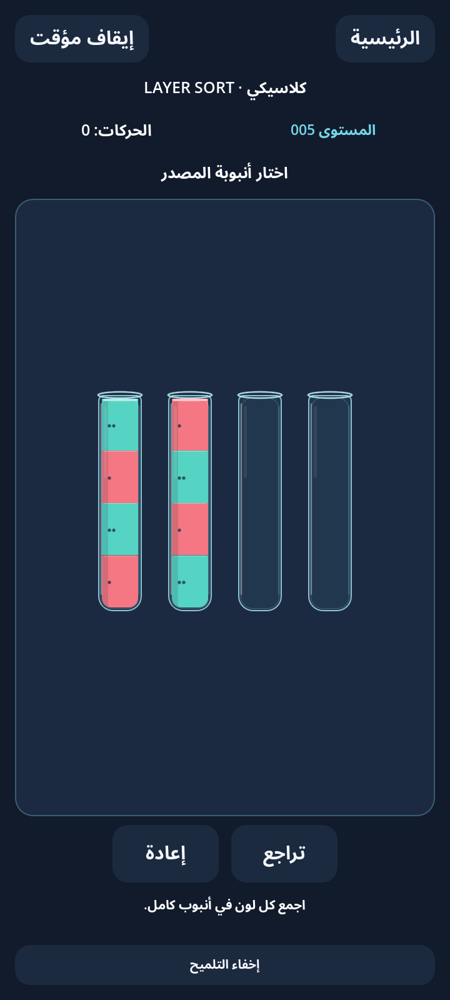 | 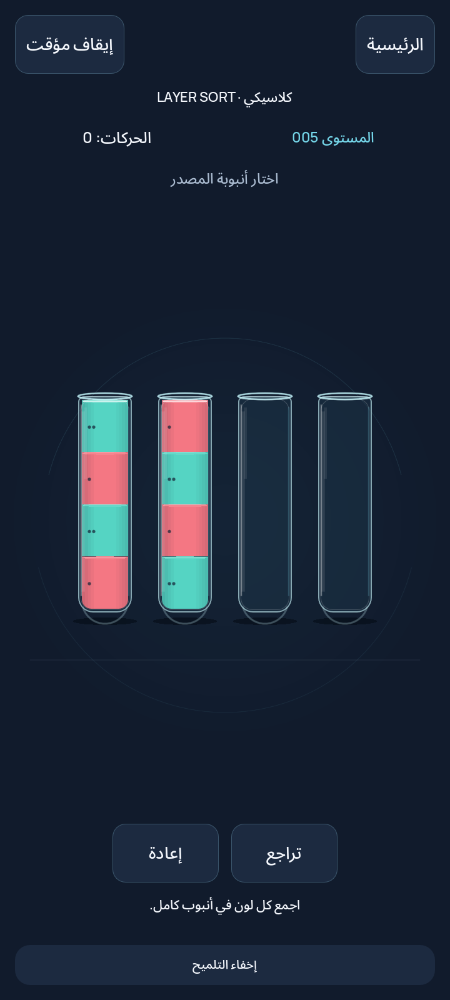 |
| 5-tubes-en | 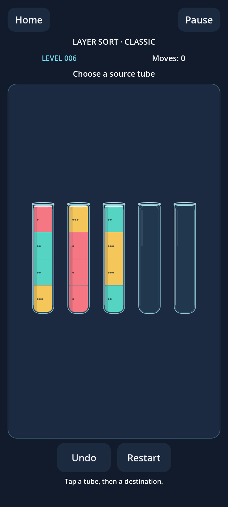 | 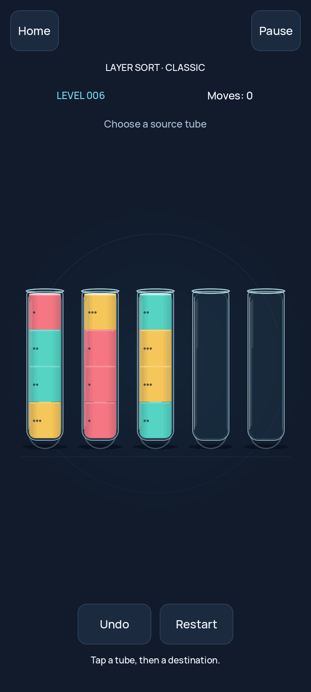 |
| 6-tubes-ar | 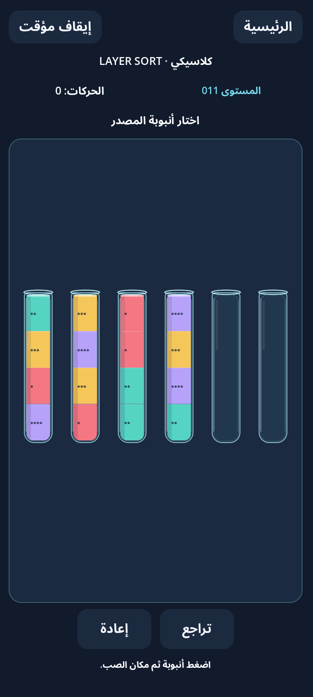 | 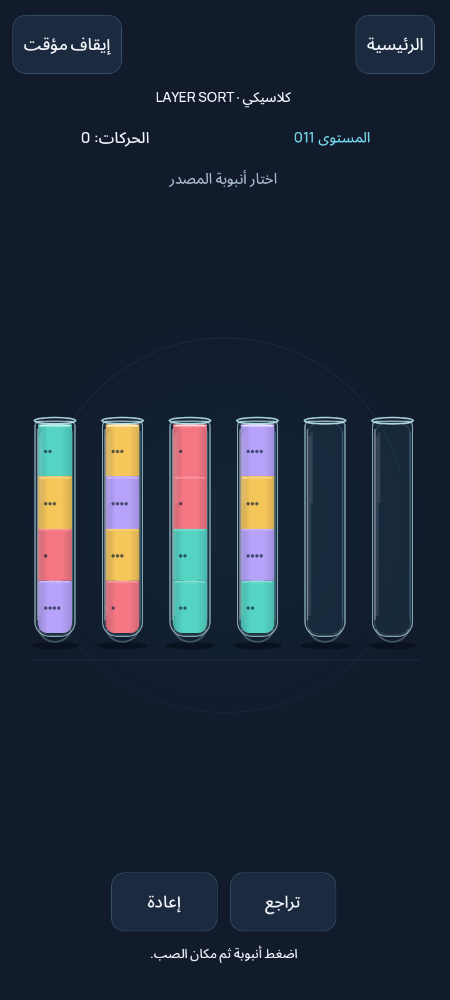 |
| narrow-6-ar | 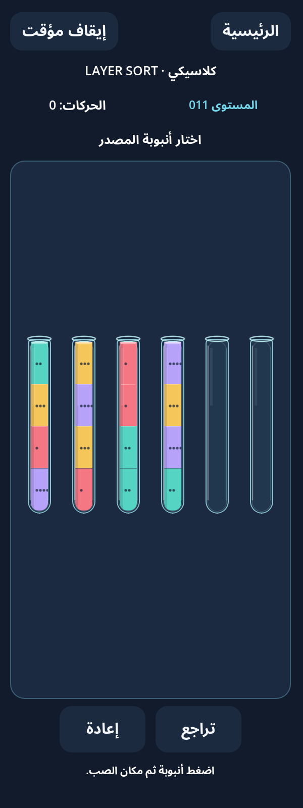 | 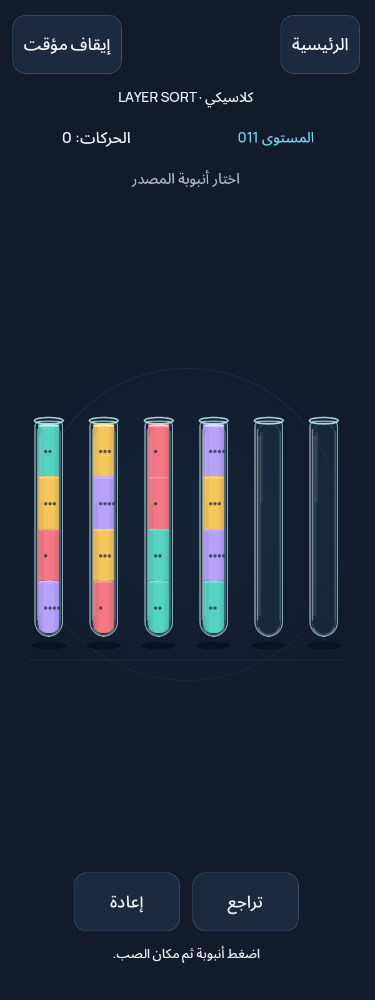 |
| selected | 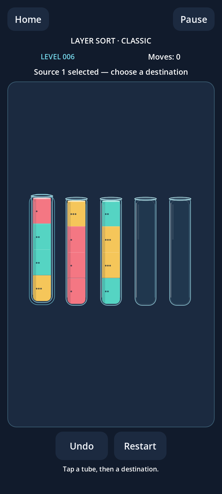 | 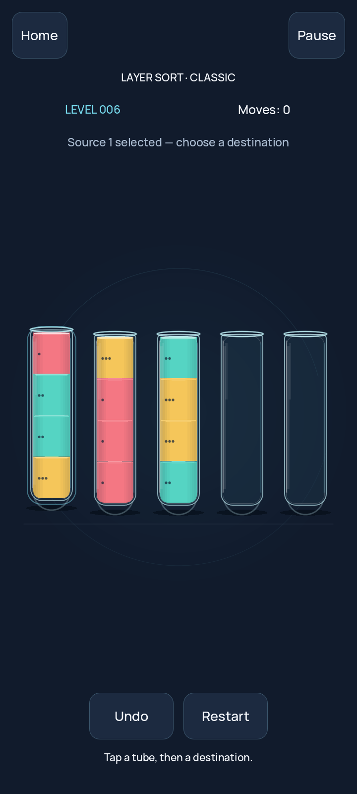 |
| pour-1 | 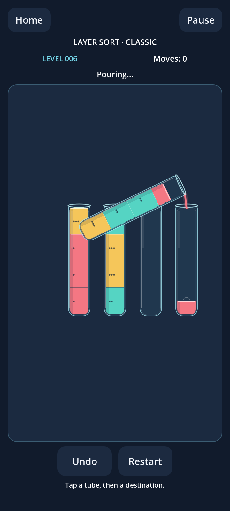 | 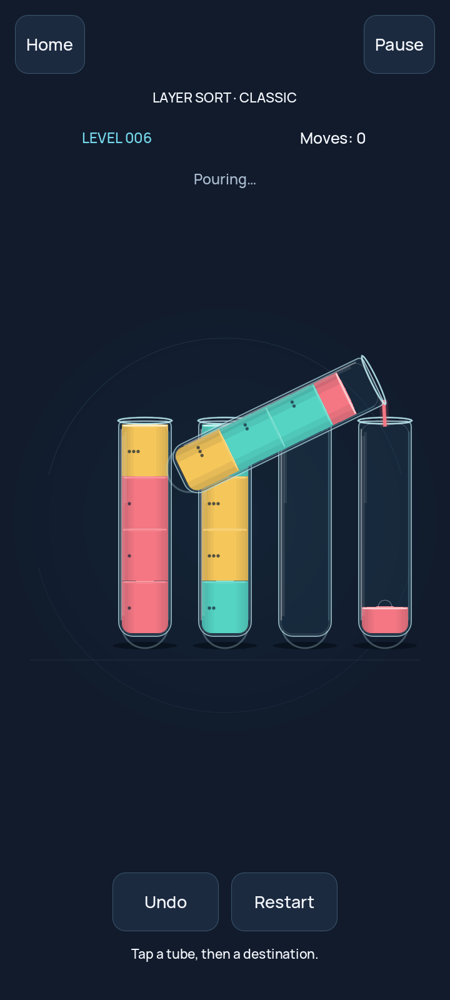 |
| completed-reduced-motion | 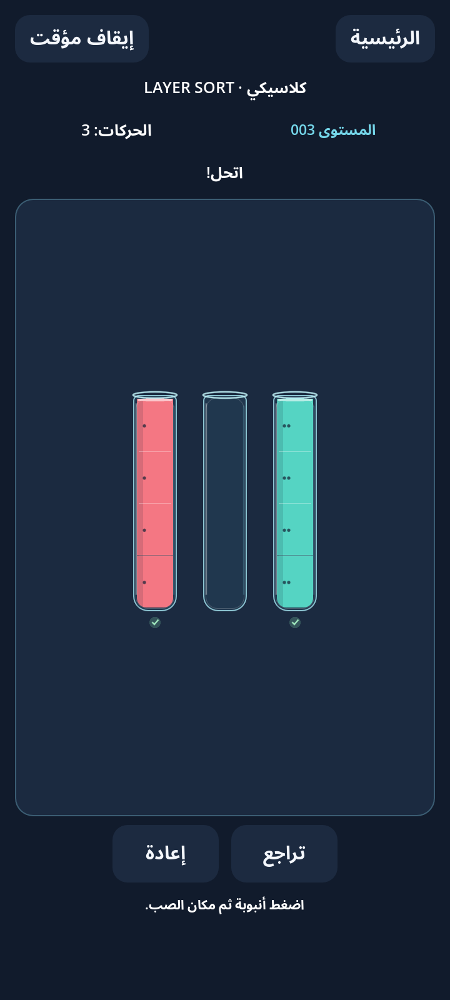 | 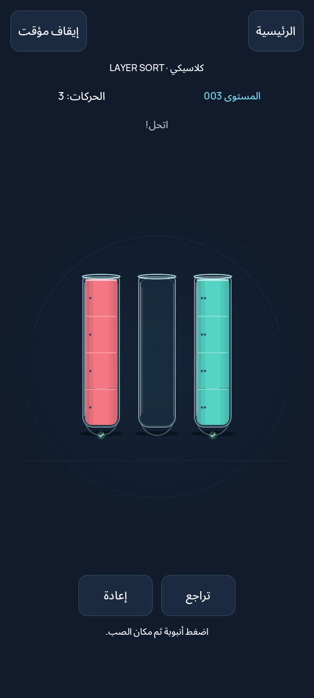 |
