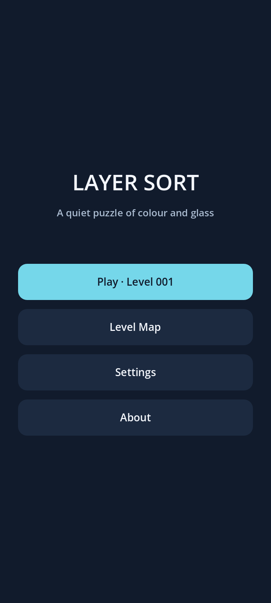
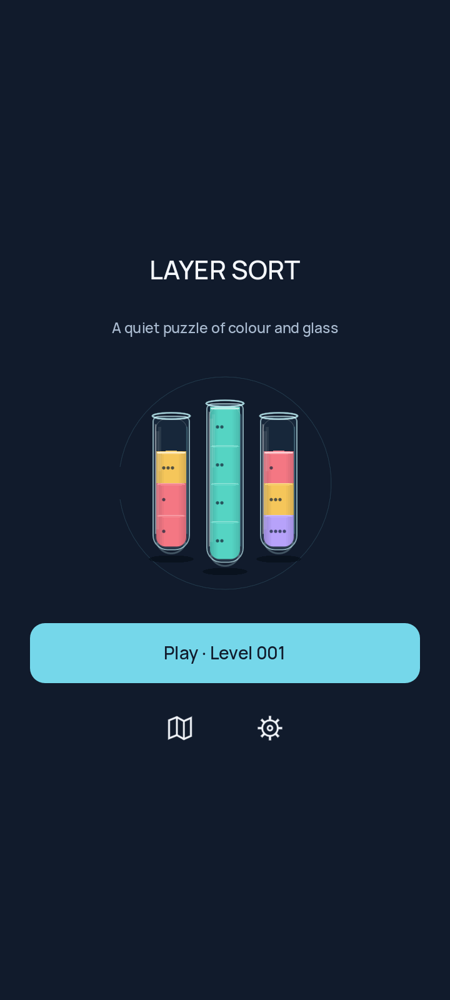
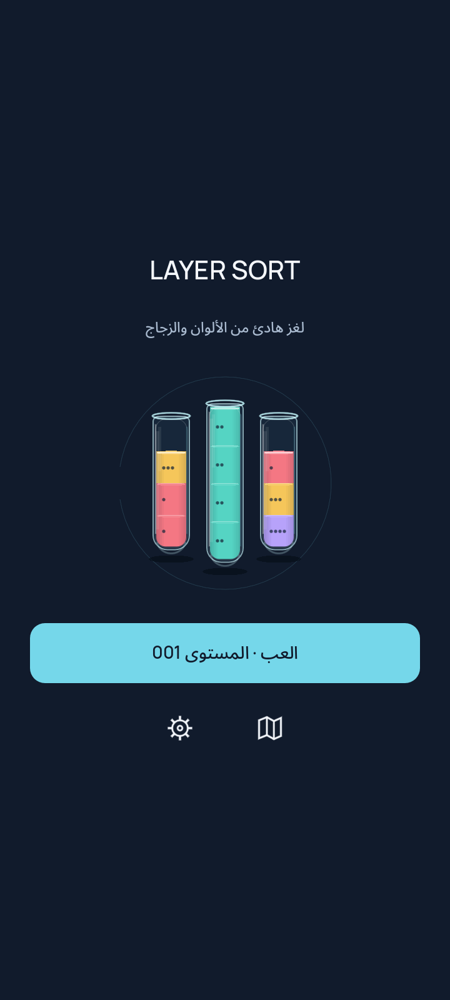
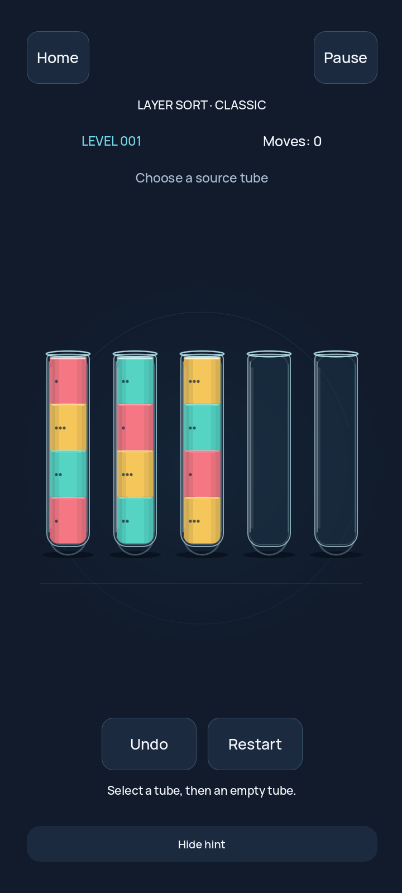
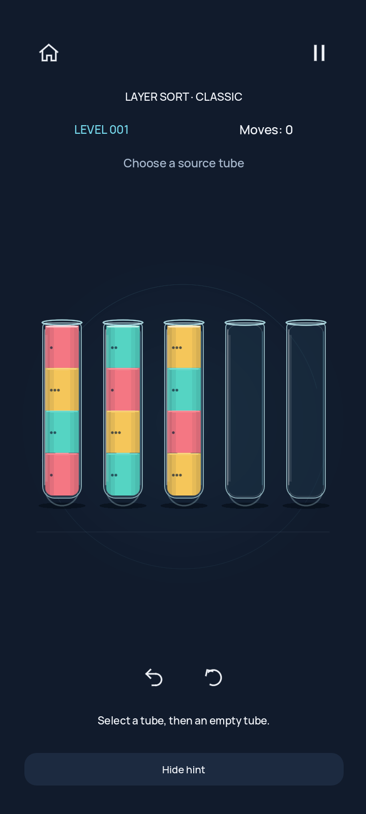
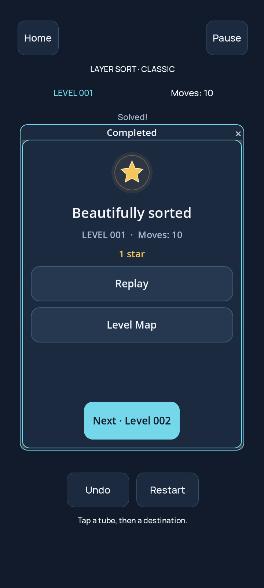
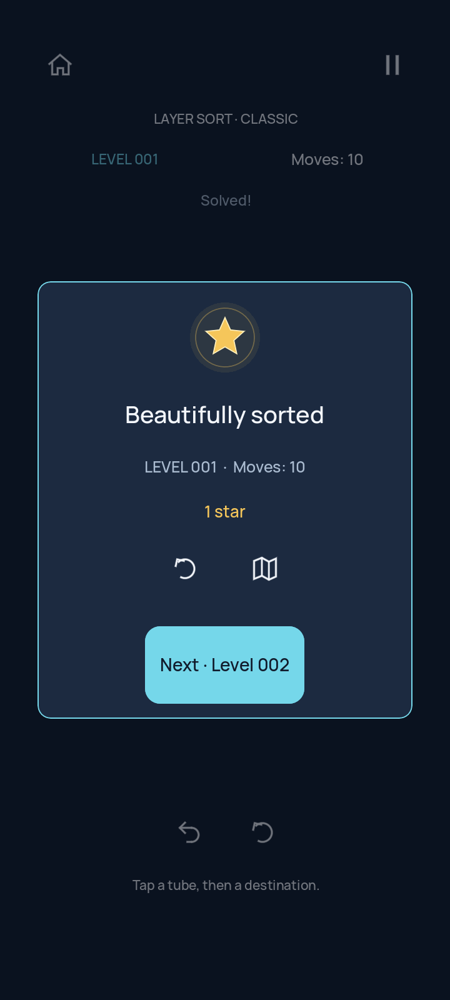
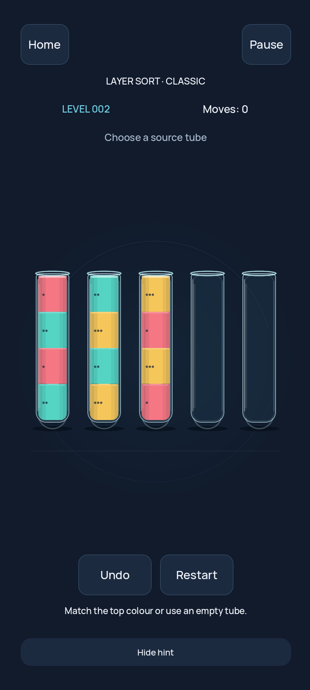
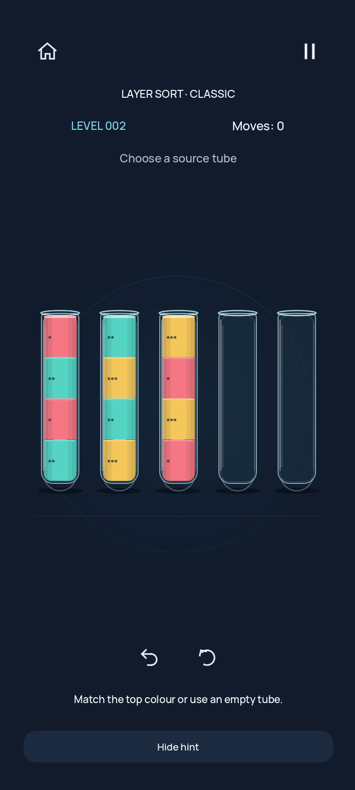
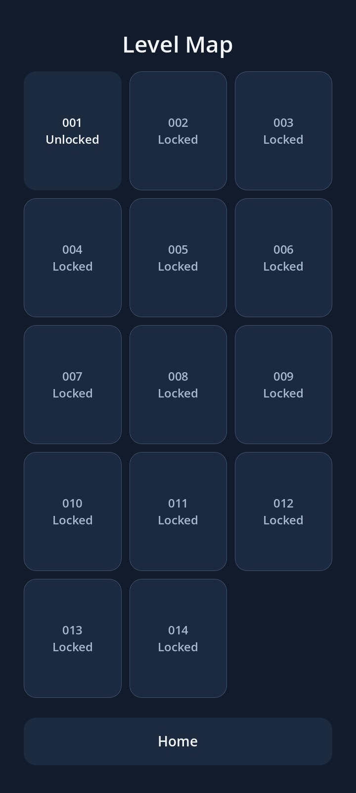

# Actual Godot viewport comparisons

Pinned4.7.2, Xorg100, Mesa llvmpipe. Baseline2480932; modifiedworkingtree committed with this evidence. 720×1600 cloud/optical,600×1333 narrow. Not OPPO captures.

| Scene | Before | After |
|---|---|---|
| 02-home |  |  |
| 06-home-ar |  |  |
| 07-classic |  |  |
| 19-win |  |  |
| 20-next-level |  |  |
| 03-map |  |  |

Other captures includePause,About,invalidmove,selection,Replay,finallevel and sampledtransfer. Optical/narrow directories contain3–6tube andArabicnarrowproofs.
